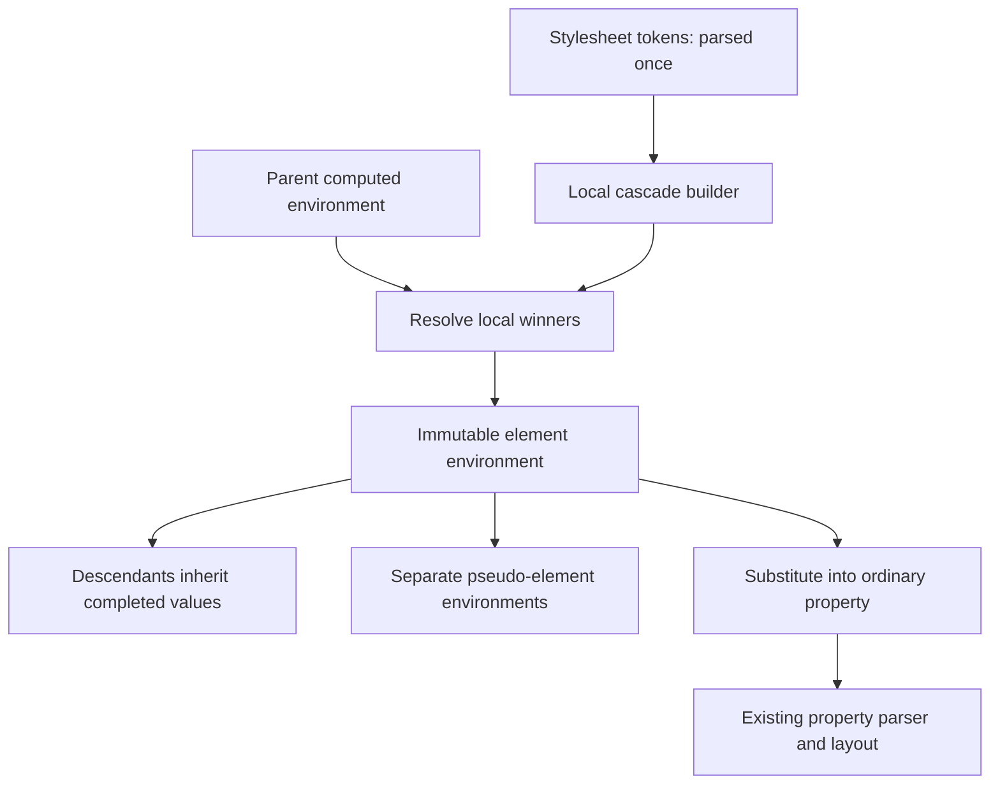

# CSS variable architecture plan

Status: first CSS implementation delivered, 25 September 2026. Parsed token
storage, computed inheritance, bounded resolution, pseudo isolation, and shared
environments are implemented. Initial scaling measurements are recorded below;
the broader restyling, memory-accounting, and frontend validation work remains.

**Objective:** make CSS variables correct and economical for a lightweight,
cross-platform browser focused on reading web pages. Keep the NetSurf-derived
architecture and the integration with libcss. Refactor the variable subsystem's
value representation, inheritance, and sharing.

This is the maintained plan for CSS variable architecture and optimization.
Performance targets must come from measurements. JavaScript/CSSOM integration
is a separate project and is outside this plan.

## Implemented and verified

The implementation replaces reconstructed value strings and lazy token caches
with immutable declaration records captured by the stylesheet parser. Internal
variable bytecode contains a property-name string ID and a declaration ID.
Completed environments retain the tokens they need after stylesheet destruction.
The selection path no longer lexes variable values from reconstructed text.

Each element collects local cascade candidates, applies defaulting and origin
rollback, then computes local values using an iterative strongly connected
component traversal. Cycles include references in unused fallback branches.
Inherited values are already computed. `::before` and `::after` have independent
local environments that inherit the originating element's completed values.

Completed environments are immutable, contain only local bindings, and retain
their parent. Empty overlays collapse to the parent. Eligible sibling style
sharing retains the same environment; it no longer copies the effective variable
table. Sharing checks the inherited snapshot so parent reselection cannot reuse
a sibling style based on the old snapshot. Deep parent release is iterative.

Expansion is limited to 65,536 emitted tokens per custom value or consuming
declaration. Fallback syntax nesting is limited to 64; dependency traversal does
not use this recursion limit. An oversized custom value becomes invalid. If
combining otherwise valid values exceeds the consumer's output limit, the
consumer becomes invalid without substituting a fallback for those valid values.
Allocation errors propagate separately from invalid CSS. A builder that fails
finalization must be destroyed; it cannot be retried or published.

Substituted ordinary values still pass through the property's existing parser
and cascade functions, including shorthand expansion. The parser must consume
the entire value. Invalid substituted declarations apply computed-value
defaulting. The refactor also fixes the old deferred `!important` path, which
set an opcode bit instead of the importance flag.

Tests cover parent aliases and child overrides, invalid inherited values,
cross-generation dependencies, empty values/fallbacks, token boundaries, escaped
strings, origin rollback, importance, inline styles, imports, pseudo isolation,
complete cyclic components, 4,096-link dependencies, expansion bounds, parent
reselection, stylesheet destruction, and a 10,000-level environment teardown.
Property integration checks include `calc()`, consumer-relative `em` units,
flex shorthand, grid tracks, SVG stroke values, and URL tokens.

### Code generators

The sources of generated behavior were audited, not just generated build output:

| Source | Generated output and interaction |
| --- | --- |
| `contrib/libcss/properties.toml`, `build-aux/property_generator.py`, `generate_cascade.py` | Property registry, dispatch, opcodes, unit masks, and cascade functions. |
| Generated `properties.gen`, C `gen_parser`, and `parser_wrapper.py` | Ordinary property parsers used after variable substitution. |
| `select_generator.py`, `select_config.py`, `assets.py`, `overrides.py` | Computed-style storage, getters, setters, and destruction. |
| Generated gperf input | Property-name lookup used by parsing and deferred resolution. |

The two special variable opcodes remain outside the generated ordinary-property
enum. Their payload still occupies two words; its second word now identifies a
parsed declaration. The hand-written producer, selector, importance walker,
skip walker, and parse golden tests agree on that format. No generator-template
change is needed for this representation. Separate build directories regenerated
the property registry, parsers, cascade code, and computed-style code from source.
No build-generated C files are checked in as fixes.

### Initial measurements

Comparison baseline: `1989ef4c712b1cceae79c73840299ea15d8b10f9`, with only the same
benchmark harness and build fixes applied. Both engines used GCC 16.2.1 on
x86-64 Linux, Release (`-O3`, LTO), assertions enabled in the harness, diagnostic
logging/performance tracing off, and no sanitizers. Each row has one warm-up per
engine and seven measured runs, alternating engine order.

The workload defines a theme on the parent and retains every child and result.
Children are eligible for sibling style sharing and consume a root variable in
width/height. Timings cover parent and child selection, excluding stylesheet
parsing, storage counting, and teardown. Values are milliseconds: median [range].
Binding counts are retained entries across distinct environments, not allocated
bytes or total allocation counts.

| Children | Root variables | Previous selection | New selection | Previous retained bindings | New retained bindings |
| ---: | ---: | ---: | ---: | ---: | ---: |
| 1,000 | 32 | 4 [4–5] | 2 [1–2] | 32,000 | 32 |
| 10,000 | 32 | 40 [37–43] | 14 [12–16] | 320,000 | 32 |
| 1,000 | 256 | 22 [20–34] | 2 [1–3] | 256,000 | 256 |
| 10,000 | 256 | 192 [174–205] | 13 [10–21] | 2,560,000 | 256 |
| 1,000 | 1,024 | 108 [100–108] | 2 [1–2] | 1,024,000 | 1,024 |
| 50,000 | 32 | 184 [171–206] | 62 [57–77] | 1,600,000 | 32 |
| 50,000 | 0 (literal control) | 66 [64–75] | 68 [65–74] | 0 | 0 |

The new root-theme cases retain one environment; the previous implementation
retains children + 1. The no-variable timing ranges overlap. Millisecond
resolution limits interpretation of the smallest cases. These results establish
eliminated inherited-table duplication in this workload, not a whole-page
rendering speedup or universal constant-time lookup.

### Validation and reproduction

- Debug: all 60 standalone libcss CTest cases pass under ASan/UBSan. LeakSanitizer
  is disabled because this environment runs under ptrace; the variable selection
  test also checks that no interned strings survive teardown.
- Release: 59/60 pass, including both variable suites and the property integration
  checks. `libcss_css21_fontface` segfaults; the same case segfaults in the baseline
  Release engine. It is a separate existing failure.
- Qt: the complete Release browser builds with normal warnings-as-errors settings.
  A follow-up makes the enum-to-float conversion explicit in the path renderer;
  the temporary compiler-warning exception is no longer needed. An offscreen
  launch with JS disabled and the local reference
  fixture stayed running until the eight-second smoke-test timeout. This is not
  visual or geometry validation. Windows was not tested.
- Check is not discoverable through `pkg-config` in this execution environment,
  despite the reported installation. Wisp's Check-based integration tests have
  therefore not run. The new `WISP_ENABLE_LIBCSS_TESTS` option permits the standalone
  CSS tests independently of Check. The CSS library now links its math dependency
  directly, which was required for standalone optimized test linking.

Reproduce the focused Debug build without changing an existing build directory:

```sh
cmake -S . -B build-css-vars -G Ninja -DCMAKE_BUILD_TYPE=Debug \
  -DWISP_ENABLE_TESTS=OFF -DWISP_ENABLE_LIBCSS_TESTS=ON \
  -DWISP_BUILD_QT_FRONTEND=OFF -DWISP_BUILD_MONKEY_FRONTEND=OFF \
  -DWISP_ENABLE_PERF_TRACE=OFF
ASAN_OPTIONS=detect_leaks=0 cmake --build build-css-vars --target \
  libcss_var_context libcss_var_resolve libcss_parse_auto libcss_parse2_auto \
  libcss_select libcss_select2 libcss_calc_props libcss_lex_auto \
  libcss_csdetect libcss_number libcss_css21
ASAN_OPTIONS=detect_leaks=0 ctest --test-dir build-css-vars --output-on-failure
```

For timing, configure a separate Release build with the same CSS test options,
build `libcss_var_resolve`, and run:

```sh
build-css-vars-release/libcss_var_resolve --benchmark 10000 256
build-css-vars-release/libcss_var_resolve --benchmark 50000 0
```

For a baseline comparison, use a separate checkout of the recorded revision,
copy in the current `var-resolve.c` harness, enable the standalone test option
and test assertions, and apply the direct libcss math-library linkage. Keep its
engine sources unchanged. Alternate seven runs of each binary with identical
arguments and report medians and ranges. The harness accepts up to 50,000
elements and 1,024 variables; its zero-variable mode is the literal control.

The static fixture `test/css-vars-architecture.html` pairs variable declarations
with literal references for flex, grid, parent aliases, pseudo scopes, and cycles.
It needs no JS or network resources. The old cycle explanation in
`test/css-vars.html` is corrected to expect the specified fallback.

### Remaining work

The phase descriptions below retain the full acceptance criteria. This delivery
implements the core of phases 2–3 and basic sharing/lifetimes from phase 4,
with partial baseline and integration work from phases 1, 5, and 6.

Native radio/checkbox changes now exercise whole-document invalidation,
including inherited custom properties, through real click tests. See
[`checked-interaction.md`](../src/docs/checked-interaction.md) for the lifetime
boundary and scope. This does not cover arbitrary state changes or DOM mutation.

Still needed: browser viewport/media/other-state/subtree invalidation coverage,
allocation-failure injection, complete memory accounting (including stylesheet
token storage), allocation/peak-byte/token-copy counters, sparse-override and
deep-scope timing sweeps, logging-overhead measurement, and page-level geometry
and visual comparisons on Qt and Windows. First-line/first-letter interactions
need dedicated coverage before claiming all pseudo-element semantics. The
existing optimized font-face failure should be diagnosed independently.

The existing two-pass selector walk remains. Rendering and reference counts
remain single-threaded; interning, computed-style arenas, and deferred property
parsing still have shared mutable state to address before parallel rendering.
The immutable declaration/environment design remains useful for that later work.

## Scope and design decisions

Keep the existing HTML parser, DOM, layout engine, platform frontends, CSS
property parsers, and token substitution approach. Keep JavaScript at its present
scope and disable it for browser-level rendering validation.

Keep style resolution, box construction, layout, and painting single-threaded
on the existing event loop for this stage. Improve reuse and scheduling within
that model. Cooperative work slices are allowed, but verify that continuations
actually return control to the frontend event loop.

Background logging threads are allowed and preferred for log output, to keep
formatting and file I/O off the rendering path where practical. Capture event
timestamps on the producing thread; pass owned records to the logger rather
than letting it inspect mutable DOM, style, or box data. Measure the remaining
recording/queue overhead and report dropped records if a bounded queue fills.

Multithreaded rendering is a future direction, deferred until the rendering
engine is more complete and accurate, with reproducible correctness tests and
performance baselines. The purpose is to distinguish existing rendering bugs
and limitations from new concurrency bugs. Introduce rendering parallelism as
separate, staged work with comparison against the single-threaded path; it is
outside this CSS-variable refactor. Immutable data and explicit ownership remain
useful foundations, but do not by themselves make the engine thread-safe.

Prioritize optimizations that reduce total work or memory regardless of thread
count: parse declarations once, share completed variable environments, avoid
redundant conversion/reflow, and remove unnecessary diagnostic traversals from
normal rendering. Require measurements and correctness checks for skipped work
and caches. Keep temporary working state in explicit document or operation
contexts, and document ownership and invalidation rather than adding global
mutable caches or scratch buffers.

Do not undertake a broad box-construction rewrite solely to improve the current
serial traversal without a measured need and a separate design review. Fix
event-loop starvation when demonstrated, but defer elaborate slice scheduling,
speculative allocation schemes, and parallel job infrastructure. Future
concurrency may separate rendering from UI/presentation or process independent
work in parallel; concurrent style/layout within one document would require
more substantial changes to shared box mutations and traversal dependencies.
Flex/grid/SVG correctness rules and regression fixtures remain valuable across
these designs, even where implementation boundaries change. The current CSS
plan commits to neither a particular worker topology nor lock-based tree access.

This work covers unregistered custom properties, ordinary declarations using
`var()`, supported pseudo-elements, and the lifetime of their style data. It does
not add cascade-layer semantics, `@property`, animations, new layout features,
or new web APIs. Existing limitations of those features must remain explicit.

[Cascade-layer ordering](css_layer_support.md) and
[additional pseudo-element rendering](phase_2_pseudo_elements.md) remain separate
follow-up plans. This plan owns variable inheritance, resolution, storage, and
scope isolation; those documents must not introduce competing variable designs.

The target model has three distinct objects:

| Object | Owner and lifetime | Purpose |
| --- | --- | --- |
| Parsed declaration | Immutable, reference-counted record associated with a stylesheet | Owns tokens and referenced variable names; reused by every matching element. |
| Cascade builder | Temporary, one per element or supported pseudo-element | Selects local winning declarations and handles cascade metadata/defaulting. |
| Computed variable environment | Immutable, reference-counted snapshot | Stores local computed token values and shares an inherited environment. |

The important rules are:

- A child inherits completed custom-property values. It cannot reinterpret a
  parent's `var()` references using its own overrides. This follows the
  [custom-property inheritance and dependency rules](https://www.w3.org/TR/css-variables-1/#cycles).
- Completed values remain tokens. A value containing `1em`, a percentage,
  `calc()`, or a URL still needs the consuming property's context. Do not cache
  a universal pixel length, color, or property bytecode against a variable name.
- Represent valid empty tokens, guaranteed-invalid values, and absent local
  bindings distinctly. An invalid local binding must mask an inherited value.
  See [custom-property values](https://www.w3.org/TR/css-variables-1/#defining-variables).
- Published environments never change. Restyling creates new snapshots and
  updates the relevant descendants through the existing style invalidation path.
- Each supported pseudo-element has its own local cascade. For `::before` and
  `::after`, its inherited environment comes from the originating element;
  declarations must not leak back into that element or into another pseudo.
  See [generated pseudo-elements](https://www.w3.org/TR/css-pseudo-4/#generated-content).



## Phase 1: establish correctness and performance baselines

Use `contrib/libcss/test/var-resolve.c` as the starting point for tests that run
the actual stylesheet parser, selector, resolver, and computed-style APIs.
Extend its node model only where necessary to exercise siblings, classes,
pseudo-elements, and restyling. Keep context-level lifetime tests separate.

Build a focused expectation matrix covering:

- Parent aliases with child overrides; a child cannot repair a variable that
  was invalid on its parent; valid dependency chains across generations.
- Local self-cycles, multi-variable cycles, references inside fallback branches,
  and valid fallbacks from invalid dependencies.
- Pseudo-element overrides and isolation from the originating element,
  descendants, and other pseudo-elements.
- Empty versus missing/invalid values; case-sensitive names; strings, escapes,
  URLs, token boundaries, and nested functions.
- Source order, specificity, inline styles, origins, importance, and supported
  CSS-wide keywords. Follow [cascade defaulting](https://www.w3.org/TR/css-cascade-5/#defaulting-keywords).
- Shorthand/longhand ordering, full consumption of substituted tokens, and
  invalid-at-computed-value behavior.

Reference relevant Web Platform Tests and specifications for expectations.
Adapt tests into the C harness or use static HTML/CSS reference fixtures;
Wisp does not need additional JavaScript to validate these behaviors.

Correct the existing child-shadow expectation of 41px to 40px alongside its
implementation fix. The current inherited-cycle test also needs a better
explanation: its fallback can be correct because the parent's value is already
invalid, without a cycle spanning the two elements. Add a valid cross-generation
case that distinguishes those behaviors.

Capture baseline timing, allocation counts/bytes, tokenization counts,
variable-table entries, and expanded-token counts. Save the revision, compiler,
build configuration, and input parameters. Record known failures rather than
treating the current test suite as the specification. Add each failing regression
with its corresponding fix so implementation commits remain reviewable.

Separate CSS selection from the rest of DOM-to-box conversion in the baseline:
`box_construct_element()` calls style selection, so an expensive "box
construction" interval may actually be variable or selector work. Also record
box-conversion starts/restarts, document reformat counts, and nested layout-call
counts. This distinguishes CSS costs from repeated box/layout processing before
choosing further optimization work. Layout and scheduler fixes belong in
separate changes so their effects can be measured independently.

**Exit:** reproducible benchmark inputs, a documented baseline, and an agreed
set of observable correctness expectations. No claimed speedup yet.

## Phase 2: store parsed declarations once

Introduce owned immutable token records for custom-property declarations and
deferred ordinary declarations. Capture tokens from the stylesheet parser;
avoid reconstructing text and then lexing it again for each matching element.
Preserve token types, boundaries, escaping, and the source context needed by
existing property parsing. Never retain pointers into temporary lexer buffers.

Continue using `lwc_string` interning for names and token text. Share immutable
token records as well as their strings; interning strings alone does not prevent
duplicate token arrays. Capture nested fallback tokens in these records so using
a fallback does not require another text-to-token conversion.

Store referenced variable names with the declaration. Represent CSS-wide
keywords explicitly in the cascade builder instead of treating them as arbitrary
substitution text. Retain enough origin information for supported rollback
behavior; do not silently turn `revert` into `inherit`.

Use stable stylesheet record identifiers in internal bytecode where necessary.
Keep all producer/consumer and destruction changes in the same commit. Audit
generated property dispatch and bytecode traversal for the new representation.

Primary files: `contrib/libcss/src/parse/language.c`, `stylesheet.[ch]`,
`select/variables.[ch]`, and internal bytecode declarations.

**Exit:** declaration tokenization scales with declaration count, rather than
the number of matching elements. Token preservation and lifetime tests pass;
existing supported rendering behavior is preserved during this representation
change.

## Phase 3: finalize values in the correct scope

Retain two logical style-selection phases initially: collect winning custom
properties, then apply ordinary declarations. Between them, finalize the base
element environment, followed by each applicable pseudo-element environment.
Temporary builders carry cascade metadata; inherited computed bindings do not.

Resolve local winners against other local winners and the parent's completed
values. Eagerly finalize local winners for the first implementation; this gives
a predictable lifetime and avoids publishing partially resolved environments.
Values with no substitutions can directly reference immutable declaration tokens.

Use a validated dependency-graph algorithm that identifies complete cyclic
components, including references in fallback branches. Inherited values are
completed inputs, not unresolved graph nodes. Mark cyclic values invalid and
allow noncyclic declarations to use valid fallbacks from them. Prefer iterative
graph traversal so a long dependency chain does not consume the C call stack.

Add a checked expansion limit shared by all substitution paths. Start with a
documented limit of 65,536 emitted tokens per expanded value/declaration;
validate it against the fixtures before finalizing the policy. Count cached
expansions before copying them and check arithmetic for overflow. A depth limit
alone is insufficient. See [expansion limits](https://www.w3.org/TR/css-variables-1/#long-variables).
Keep allocation failure distinct from invalid CSS and propagate errors correctly.

Continue passing substituted ordinary-property tokens through existing property
parsers. Preserve shorthand participation in the cascade and validate that no
trailing garbage is silently accepted. A substitution failure must apply the
appropriate computed-value default, not revive an earlier losing declaration.

Primary files: `select/variables.[ch]`, `select/select.[ch]`, and the variable
resolution tests.

**Exit:** inheritance, cycles, defaulting, shorthand behavior, pseudo isolation,
and expansion-limit tests pass through the real selection pipeline. Local
overrides cannot alter an already published ancestor environment.

## Phase 4: make sharing and restyling economical

For elements with no effective local changes, retain the inherited environment
directly. For changed environments, store local computed bindings plus a parent
reference. Avoid allocating an empty overlay for every DOM level.

Replace the full effective-table clone in the existing style-sharing path with
a reference to the completed environment. Check that sharing eligibility includes
the inherited environment and applicable rules; similar computed ordinary styles
alone are not sufficient evidence that variable environments are equivalent.
Start with reuse supported by existing eligibility checks. General environment
interning is optional and should require evidence that it saves enough memory.

Update ownership and cleanup for base and pseudo environments. Test stylesheet
destruction, node-data destruction, partial failures, repeated selection, and
subtree replacement. Ensure teardown of a deep parent chain is stack-safe.

Trace existing invalidation paths for viewport/media changes, selector state,
and stylesheet changes. Rebuild affected snapshots and reselect descendants
conservatively when an inherited environment changes. Do not add fine-grained
dependency invalidation in this project unless measurements require it.

Primary files: `select/select.[ch]`, `select/variables.[ch]`, and Wisp's existing
libcss node-data/invalidation callbacks where integration requires changes.

**Exit:** a large inherited root theme is shared across ordinary descendants and
eligible siblings. Repeated restyling releases old snapshots after their last
reference and never reuses stale variable-dependent styles.

## Phase 5: measure scaling and optimize only demonstrated costs

Use independent sweeps of element count and variable count, not one representative
website. Include both the libcss harness and static browser fixtures with JS off.

| Workload | Suggested sizes | What it tests |
| --- | --- | --- |
| Root theme, repeated children | 1k/10k/50k elements; 32/256/1,024 variables | Inheritance and sibling sharing without N × V binding copies. |
| Declaration matching many elements | Same element sweep; one shared class | Parsed declaration reuse. |
| Sparse local overrides | One override on every twentieth element | Memory proportional to actual local differences. |
| Deep scopes | Depth 32/256/1,024, with and without local changes | Lookup cost and stack-safe cleanup. |
| Dependencies and expansion | Chains, diamonds, cycles, just below/above the limit | Reuse, predictable failure, and bounded output. |
| Restyling and ordinary pages | Repeated media/state changes; matching no-variable control | Reclamation and costs outside the variable-heavy cases. |

Measure style-selection time separately from layout and painting, with verbose
diagnostic logging disabled for baseline timing. Dedicated performance records
may use the background logger; compare runs with instrumentation enabled and
disabled to quantify its overhead. Report repeated-run medians and variation,
allocation counts, peak live bytes, copied bindings/tokens, and graph visits.
Instrumentation should be portable and opt-in, usable in optimized benchmark
builds independently of debug logging and sanitizers. Use platform-specific
profilers as supplements.

The primary structural target for the root-theme case is variable storage near
O(V + N) bookkeeping, not O(N × V). General workloads also include the cost of
local definitions and actual expanded output. Overlay lookups can still depend
on scope depth; do not claim constant-time lookup for the entire chain.

If duplicate selector matching is a measured bottleneck, retain matched-rule
references during collection and replay them for ordinary declarations. Preserve
origin, order, importance, pseudo scope, and media filtering. Compare the saved
CPU work with the temporary-list memory cost before adopting this optimization.
Likewise, add bounded lookup caches only if deep-scope measurements justify them.

**Exit:** publish before/after results. Demonstrate eliminated inherited-table
duplication and per-element tokenization, bounded expansion, and no unexplained
regression in the no-variable control. Investigate repeatable timing regressions
above measurement noise; do not promise an arbitrary percentage improvement.

## Phase 6: integration and completion

Run the existing libcss parse/select/calc tests, the variable tests, and the
relevant Wisp layout/rendering regressions. Use assertions-enabled builds for
correctness tests; existing tests contain setup calls inside assertions, so an
optimized benchmark harness must not lose required work under `NDEBUG`.

Validate static fixtures in the Qt frontend and the Windows frontend when that
toolchain is available. Keep fixtures local and repeatable. Include inheritance,
pseudo content, gradients, `calc()`/relative units, and flex/grid sizing through
variables. Compare expected computed styles and geometry as well as appearance.
Record unavailable platform checks explicitly.

Preserve two useful fixture patterns from earlier site investigations. These are
historical motivations for local tests, not claims about the current live sites:

- A CTV News-style header whose `display`, alignment, and minimum size come from
  variables. Compare it with a literal-value reference: variable substitution
  must preserve the horizontal flex layout and its geometry.
- A StartupCafe-style page with hundreds of root theme variables and literal
  flex/grid declarations. Check color and typography as well as dimensions:
  variable-driven font changes can affect line wrapping and page layout.

Use the same expected output for direct literals and their equivalent variable
forms. Isolate other rendering concerns from these fixtures: sticky positioning,
theme color functions such as `light-dark()`, and image decoding were separate
diagnostic leads in the historical reports and need independent reproductions
if they recur. Old site counts, support matrices, timings, and log sizes are not
current baselines. Keep verbose layout logging off during timing measurements.

Use ASan/UBSan where supported for ownership/error paths and repeated teardown.
Build with Ninja's default parallelism; do not add fixed job limits. Keep the
existing build directory intact by using a separate implementation/test build.

Remove obsolete caches, cloning paths, and comments that encode child-scope
reinterpretation. Update this document with the implemented design and measured
results when this work is complete. Document value ownership, environment
immutability, supported semantics, limits, and remaining exclusions here.

**Done means:** the specified correctness cases pass, shared inheritance has the
intended memory behavior, expansion is bounded, restyling/lifetime checks pass,
and benchmark results are reproducible. JavaScript behavior has not expanded.

## Delivery sequence

Implement the phases in order, using small reviewable commits: baseline/harness;
parsed values; correct resolution and scopes; sharing/lifetimes; measured
optimizations if warranted; integration and documentation. Each semantic change
ships with its distinguishing regression tests. Avoid combining layout fixes or
unrelated CSS features with this refactor, so regressions remain attributable.

The first implementation milestone is phases 1–3: correct, bounded variable
resolution. The second is phases 4–6: economical sharing with measured behavior
and frontend validation. No browser-wide rewrite is part of either milestone.
